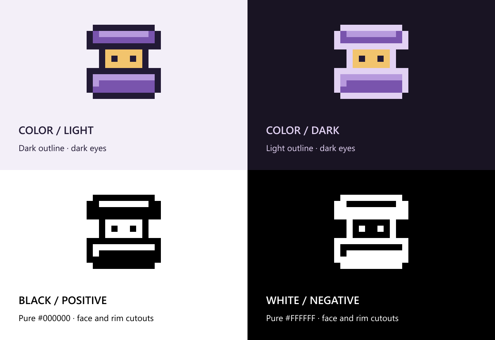

# Shulvyr branding

Logos and visual assets for [Shulvyr](https://github.com/Shulvyr/Shulvyr).



## Logos

| Version | Use on | SVG | PNG |
|---|---|---|---|
| Color with a dark outline | Light backgrounds | [SVG](assets/brand/shulvyr-mark.svg) | [32px](assets/brand/shulvyr-icon-32.png), [256px](assets/brand/shulvyr-icon-256.png) |
| Color with a light outline | Dark backgrounds | [SVG](assets/brand/shulvyr-mark-dark.svg) | [32px](assets/brand/shulvyr-icon-dark-32.png), [256px](assets/brand/shulvyr-icon-dark-256.png) |
| Black | Light backgrounds | [SVG](assets/brand/shulvyr-mark-black.svg) | [32px](assets/brand/shulvyr-icon-black-32.png), [256px](assets/brand/shulvyr-icon-black-256.png) |
| White | Dark backgrounds | [SVG](assets/brand/shulvyr-mark-white.svg) | [32px](assets/brand/shulvyr-icon-white-32.png), [256px](assets/brand/shulvyr-icon-white-256.png) |

PNG logos are available at 16, 32, 128 and 256 pixels. The black and white versions use transparent cutouts for the face and highlights.

## Other assets

- Wordmarks: [color on light](assets/brand/shulvyr-wordmark.svg), [color on dark](assets/brand/shulvyr-wordmark-light.svg), [black](assets/brand/shulvyr-wordmark-black.svg), [white](assets/brand/shulvyr-wordmark-white.svg).
- Avatars: [light](assets/brand/shulvyr-avatar-512.png), [dark](assets/brand/shulvyr-avatar-dark-512.png).
- [Banner](assets/brand/shulvyr-banner.png) and [brand sheet](assets/brand/shulvyr-brand-board.png).

Choose the version that suits the background. Preserve the pixel grid, proportions and transparent padding. Enlarge PNGs by whole-number scale factors to keep their edges sharp.

## Editing

The logo is drawn on a [16px grid](assets/brand/source/shulvyr-pixels-16.json). The [32px grid](assets/brand/source/shulvyr-pixels.json) repeats each cell as a 2x2 block.

Export and check the assets with Node.js:

```sh
node tools/branding/build.mjs
node tools/branding/build.mjs --check
```

PNG previews of the SVG layouts use Sharp. Set `SHULVYR_SHARP_MODULE` to its module entry point and run `node tools/branding/build.mjs --render-previews`.
